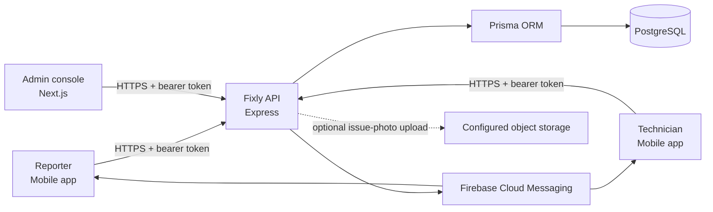
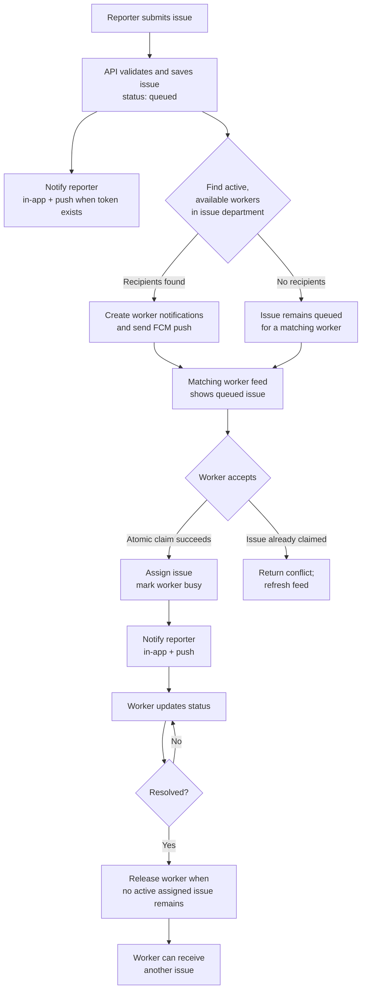

# Fixly — Campus Maintenance & Facilities Platform

Fixly is a campus issue-reporting and facilities-dispatch platform. It consists of a React Native mobile app for reporters and technicians, a role-scoped web console for supervisors and administrators, and a TypeScript API backed by PostgreSQL.

This guide covers the implemented features, the main user and notification flows, the project layout, and local development setup.

## Contents

- [Project at a glance](#project-at-a-glance)
- [Architecture](#architecture)
- [Roles and access](#roles-and-access)
- [Implemented issue workflow](#implemented-issue-workflow)
- [Worker assignment rules](#worker-assignment-rules)
- [Notifications and push delivery](#notifications-and-push-delivery)
- [Other implemented features](#other-implemented-features)
- [Project structure](#project-structure)
- [Technology stack](#technology-stack)
- [Local development setup](#local-development-setup)
- [Environment configuration](#environment-configuration)
- [Commands](#commands)
- [API overview](#api-overview)
- [Database and deployment notes](#database-and-deployment-notes)

## Project at a glance

| Application | Purpose | Main technologies |
| --- | --- | --- |
| `Mobile/` | Reporter and technician experiences on iOS, Android, and web preview | React Native, Expo, TypeScript |
| `admin/` | Supervisor and Super Admin operations console | Next.js, React, TypeScript |
| `backend/` | Authentication, permissions, issue dispatch, notifications, and data API | Node.js, Express, TypeScript, Prisma, PostgreSQL |



## Architecture

- The backend is the source of truth for account roles, department boundaries, issue status, worker availability, and assignment.
- The mobile and admin clients call the backend API; they do not decide whether a user is authorized to see or change a record.
- Prisma provides database access and migrations.
- Push devices are registered to authenticated accounts. The backend uses Firebase Cloud Messaging (FCM) to send push notifications.
- API requests that require authentication use bearer tokens. The legacy `x-role` and `x-department` headers are not credentials and must not be used as an authorization mechanism.
- Issue operations, assignments, and administrative changes write audit records.

## Roles and access

| Role | Main capabilities | Data scope |
| --- | --- | --- |
| `user` | Submit issues, see issue progress, receive notifications, and provide feedback for resolved issues | Their own reports and notifications |
| `worker` | See matching open jobs while available, accept a job, update assigned work, and review work/performance information | Their assigned work and matching available jobs |
| `department_supervisor` | Review and manage issues, workers, shifts, and operations for their department | Their own department; checked by the API |
| `super_admin` | Manage campus-wide issues, workers, users, settings, analytics, and escalations | Campus-wide |

The backend applies role and department checks to API requests. A department supervisor cannot use the client to bypass the department scope.

## Implemented issue workflow

1. A signed-in reporter submits issue details from the mobile app: title, description, category/department, and location. An issue photo is optional.
2. The backend validates the request and creates an issue in the `queued` state.
3. The reporter receives an in-app confirmation and, if they have a registered push device, a push notification.
4. Available technicians in the issue's department are selected as dispatch recipients. They receive an in-app notification and push notification, and the queued issue is returned by their worker job-feed API.
5. An eligible technician accepts the job. The backend atomically assigns the queued issue to that technician and marks the technician busy. If another technician has already accepted it, the accept request fails rather than creating a duplicate assignment.
6. The reporter receives an in-app assignment notification and push notification naming the technician.
7. The assigned technician updates the issue as work progresses and when it is resolved. The reporter receives issue-status updates.
8. Once the technician has no unresolved assigned issues, the backend makes them available for another job.



### Issue statuses

The API models issue statuses as:

- `queued` — submitted and awaiting assignment.
- `assigned` — accepted by or assigned to a technician.
- `in_progress` — work is underway.
- `resolved` — work is complete.
- `escalated` — flagged for administrative attention.

Supervisors and Super Admins can manage issues in the admin console. Workers can update only their own assigned issues and are restricted to the worker status transitions enforced by the API.

## Worker assignment rules

The worker dispatch rules are enforced in the backend:

- Only a worker marked `available` can see jobs in their feed.
- A worker sees queued, unassigned issues in the worker's department.
- Accepting is conditional on the issue still being queued and unassigned, and on the worker still being available. The assignment and busy state are saved transactionally.
- A worker can have only one unresolved assigned issue at a time. Accept and manual assignment cannot add a second active job to a busy worker.
- The feed is refreshed when opened. A foreground push notification also triggers a fresh feed request, so new work can appear without relying on stale cached data.
- Resolving the current job makes the worker available once no other unresolved assigned issue remains.
- Supervisors can manually assign or reassign issues, but the target technician must be available. When an issue is moved away from a worker, that worker is released if no other active issue remains.

## Notifications and push delivery

In-app notifications are stored for the receiving account. Push notifications are sent to that account's registered device tokens when available.

| Event | Recipients | Notification |
| --- | --- | --- |
| Issue submitted | Reporter | Submission confirmation |
| Issue submitted | Available workers in the issue department | New issue available |
| Issue accepted or assigned | Reporter | Technician assigned |
| Issue status changes | Reporter | Status-specific update |
| Issue escalated | Reporter and available workers in the issue department | Escalation alert |
| Admin sends a broadcast | Accounts in the selected audience | Admin-authored message |
| New account/device registration | Account (where applicable) | Welcome notification |

Push delivery depends on device permission, a registered token, and the Firebase/APNs configuration for the target platform. In-app notifications remain available through the authenticated notifications API. Native Google sign-in and FCM require an installed native development or production build; Expo Go does not support these configured native integrations.

## Other implemented features

### Mobile application

- Reporter and technician navigation and role-specific screens.
- Issue submission with location details and optional photo selection/capture.
- Reporter issue list, status tracking, notifications, and resolved-issue feedback.
- Technician job feed, job acceptance, active task screens, availability, and performance views.
- API response caching with refresh/invalidation hooks; worker jobs are force-refreshed when the feed is opened.
- Firebase authentication integration and Google sign-in support, subject to provider configuration.

### Admin console

- Issue queue and escalation queue.
- Issue editing, assignment, and reassignment.
- Worker and shift management.
- User/account management for Super Admins.
- Department-scoped supervisor views and actions.
- Operational analytics, audit history, notifications, and app configuration.

### Backend

- Email/password and Google/Firebase authentication endpoints.
- Bearer-token authentication and server-side role checks.
- Department-scoped issue and worker queries.
- Issue lifecycle, assignment, reassignment, and feedback endpoints.
- Push-device registration and notification APIs.
- Analytics, shifts, audit records, and app configuration endpoints.
- Prisma schema and checked-in database migrations.

## Project structure

```text
fixly-app/
├── Mobile/
│   ├── src/
│   │   ├── components/    # Shared mobile UI
│   │   ├── context/       # Authentication and app-level state
│   │   ├── hooks/         # API refresh and system UI hooks
│   │   ├── lib/           # API, Firebase, push, and issue helpers
│   │   ├── navigation/    # Role-specific and root navigation
│   │   └── screens/       # Reporter, worker, and shared screens
│   ├── assets/            # App icons, logos, and splash assets
│   └── app.config.js      # Expo configuration and native plugins
├── admin/
│   └── src/
│       ├── app/           # Next.js application and global styles
│       ├── components/    # Admin, issue, worker, and user UI
│       └── lib/           # Admin API client and types
├── backend/
│   ├── prisma/            # Prisma schema, migrations, and demo seed
│   └── src/
│       ├── controllers/   # HTTP handlers
│       ├── db/            # Prisma client and application data operations
│       ├── middleware/    # Authentication and role checks
│       ├── routes/        # API route registration
│       └── services/      # Push, storage, and notification services
└── README.md
```

## Technology stack

- **Mobile:** Expo, React Native, TypeScript, React Navigation, Firebase, AsyncStorage.
- **Admin:** Next.js 16, React, TypeScript, ESLint.
- **Backend:** Node.js, Express, TypeScript, Prisma ORM, PostgreSQL.
- **Push and identity integrations:** Firebase Cloud Messaging, Firebase authentication/token verification, Google sign-in, and APNs configuration for iOS delivery.
- **Photo storage:** issue photos are uploaded by the backend to Cloudflare R2 through its S3-compatible API. The backend also generates a public or signed URL for viewing the photo.

## Local development setup

Requirements: Node.js, npm, and Docker Compose for local PostgreSQL.

### 1. Configure and start the database

```bash
cd backend
cp .env.example .env
```

Set a unique `POSTGRES_PASSWORD` and a `JWT_SECRET` of at least 32 characters. Keep `.env` private. For local development, `DATABASE_URL` and `DIRECT_DATABASE_URL` should point to the Docker PostgreSQL service.

Start PostgreSQL and deploy the checked-in migrations:

```bash
docker compose up -d
npm install
npm run db:deploy
npm run db:generate
```

Backend startup verifies that the database contains an active Super Admin account. Create or reactivate that account through your trusted database provisioning process before starting the API. The application does not create accounts or assign admin IDs automatically. Startup does not insert sample records by default.

To add optional demo accounts and sample issues to the configured database:

```bash
npm run db:seed:demo
```

Remove the demo records later with:

```bash
npm run db:seed:demo:remove
```

### 2. Start the backend

In a new terminal:

```bash
cd backend
npm run dev
```

- Health check: `http://localhost:5001/health`
- API base: `http://localhost:5001/api`

### 3. Start the admin console

In another terminal:

```bash
cd admin
cp .env.example .env.local
npm install
npm run dev
```

Set `NEXT_PUBLIC_API_URL` in `admin/.env.local` to the reachable API URL, then open `http://localhost:3000` and sign in with an active Super Admin account provisioned in the database.

### 4. Start the mobile application (optional)

```bash
cd Mobile
cp .env.example .env
npm install
npm run dev
```

Configure the mobile app environment variables, including `EXPO_PUBLIC_API_URL`. On a physical device, use an API host address reachable from that device; `localhost` on the phone points to the phone itself.

For Android and iOS native builds, provide Firebase app configuration as `Mobile/google-services.json` and `Mobile/GoogleService-Info.plist` respectively. These files are ignored by Git. The Expo config detects available files and derives the iOS Google URL scheme from `EXPO_PUBLIC_GOOGLE_IOS_CLIENT_ID`.

Google sign-in, native FCM, and native image-picker capabilities require an installed development or production build. Expo Go is not supported for these native integrations. Android and iOS push delivery also requires Firebase and APNs setup. Web push requires a VAPID key and browser service-worker support; it is separate from native FCM registration.

Issue and profile-photo uploads are handled by the backend, not by direct Firebase Storage uploads. Configure the backend's `R2_ENDPOINT`, `R2_BUCKET_NAME`, `R2_ACCESS_KEY_ID`, and `R2_SECRET_ACCESS_KEY`; optionally set `R2_PUBLIC_BASE_URL` to serve public photo URLs. Google profile photos are copied to R2 during Google sign-in and their R2 URL is stored in the user record. Without R2 configuration, issue creation without a photo still works, while photo uploads return a configuration error.

Use `a` or `i` in the Expo terminal for a native run, or `w` for the web preview.

## Environment configuration

Copy the sample environment file for the application you are configuring, then provide the values in your local ignored environment file:

| File | Important configuration |
| --- | --- |
| `backend/.env` | Database connection, JWT signing secret, Firebase Admin credentials, and R2 storage configuration |
| `admin/.env.local` | `NEXT_PUBLIC_API_URL` |
| `Mobile/.env` | `EXPO_PUBLIC_API_URL`, Firebase client settings, Google client IDs, and optional web-push VAPID key |

Backend Firebase Admin values (`FIREBASE_PROJECT_ID`, `FIREBASE_CLIENT_EMAIL`, and `FIREBASE_PRIVATE_KEY`) are server credentials. Never put service-account private keys in mobile or web client configuration. Client-side `EXPO_PUBLIC_*` settings are bundled into the app and must not contain server secrets.

The R2 backend credentials (`R2_ACCESS_KEY_ID` and `R2_SECRET_ACCESS_KEY`) are also server-only. `R2_PUBLIC_BASE_URL`, if configured, is used to build photo URLs and should point to the intended public delivery host.

Local `.env` files, native Firebase configuration files, signing credentials, and service-account files must not be committed.

## Commands

Run commands from the named application directory.

| Directory | Command | Purpose |
| --- | --- | --- |
| `backend/` | `npm run dev` | Generate Prisma Client and run the API in watch mode |
| `backend/` | `npm run build` | Generate Prisma Client and compile TypeScript |
| `backend/` | `npm start` | Start the compiled API |
| `backend/` | `npm run db:generate` | Generate Prisma Client |
| `backend/` | `npm run db:migrate` | Create/apply a development migration |
| `backend/` | `npm run db:deploy` | Apply committed migrations |
| `backend/` | `npm run db:seed:demo` | Add optional demo data |
| `admin/` | `npm run dev` | Start Next.js development server |
| `admin/` | `npm run build` | Build the admin app for production |
| `admin/` | `npm run start` | Serve the production build |
| `admin/` | `npm run lint` | Run ESLint |
| `Mobile/` | `npm run dev` | Start Expo |
| `Mobile/` | `npm run android` | Build/run the Android app through Expo |
| `Mobile/` | `npm run ios` | Build/run the iOS app through Expo |
| `Mobile/` | `npm run web` | Start the web preview |
| `Mobile/` | `npm run typecheck` | Type-check the mobile app |

## API overview

All API routes are under `/api`. Authentication is required except where noted.

| Resource | Route examples | Purpose |
| --- | --- | --- |
| Authentication | `POST /auth/login`, `POST /auth/register`, `POST /auth/google`, `GET /auth/me` | Sign in, register, and retrieve the current account |
| Issues | `GET /issues`, `POST /issues`, `PATCH /issues/:id`, `PATCH /issues/:id/status` | List, create, edit, and advance issues |
| Worker dispatch | `GET /worker/jobs`, `POST /issues/:id/accept` | List eligible jobs and atomically accept a job |
| Worker profile | `GET /worker/me`, `GET /worker/performance`, `PATCH /worker/me/status` | Retrieve performance and manage availability |
| Notifications | `GET /notifications`, `GET /notifications/unread-count`, `PATCH /notifications/:id/read` | Read and manage in-app notifications |
| Push devices | `POST /devices/push-token`, `DELETE /devices/push-token` | Register or unregister an authenticated device |
| Administration | `/workers`, `/shifts`, `/analytics`, `/audit`, `/users` | Manage operations, scoped by role and department |

The complete route definitions and per-route role requirements are in `backend/src/routes/api.ts`.

## Database and deployment notes

- Keep the named Docker volume to retain local PostgreSQL data between container restarts.
- Stop the local database with `docker compose down`.
- Removing the `fixly-postgres-data` volume permanently deletes local database records.
- Create and review Prisma migrations when changing `backend/prisma/schema.prisma`.
- Use `npm run db:generate` after Prisma schema changes.
- In production, apply reviewed migrations with `npm run db:deploy` before starting the new backend version. Do not use `migrate dev` or `migrate reset` against production.
- For a hosted PostgreSQL service such as Neon, configure `DATABASE_URL` for the runtime and `DIRECT_DATABASE_URL` for direct migration connections.
- The app name and version are managed through the admin settings and stored in the database; they are not backend environment variables.
- Build the admin Docker image with `--build-arg NEXT_PUBLIC_API_URL=https://<your-api-host>/api` so the client bundle targets the deployed backend.
- Keep database, JWT, Firebase Admin, storage, and signing credentials in private server/build environment configuration—not source code or client bundles.
